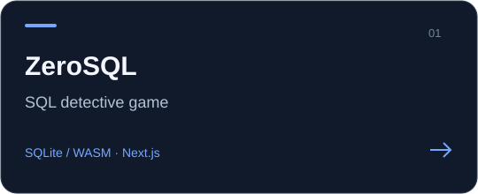

# ZeroSQL: Полынья

Браузерный SQL-детектив. Полярная ночь, город Полынья, цокольный этаж ГУ МВД. Игрок — дежурный аналитик ОЦР, его единственный инструмент — SQL к ведомственной системе «Зеркало». **Запросы — это геймплей**: игра проверяет результат запроса, а не его текст, и засчитывает любой корректный запрос.

- **13 дел**: пролог «Нулевой этаж», десять дел, интерлюдия «Черновик» и финал «Первое солнце» — от `SELECT *` до оконных функций, рекурсивных CTE, транзакций и представлений.
- **Мир генерируется в браузере**: детерминированная база примерно на 55 тыс. строк (полсотни таблиц, суточные ритмы, фоновый шум, опечатки), посаженные факты дел и пасхалки. Серверной части нет.
- Сцены и реплики, допросы «Наушник» (надавить, предъявить карточку), протокол-заключение с пакетной сверкой, обвинения, живые события по игровым часам, пять концовок.
- 33 отметки в личном деле, 22 тайника, справочник SQL, открывающийся по делам.

## Стек

| Слой | Технология |
|------|-----------|
| Фреймворк | Next.js 16 (App Router), React 19 |
| База | sql.js 1.14 (SQLite → WASM), в Web Worker; байты мира кешируются в IndexedDB |
| Редактор | CodeMirror 6 (`@uiw/react-codemirror`, `@codemirror/lang-sql`) |
| Состояние | Zustand 5, сохранение в localStorage с версией схемы |
| UI | Tailwind CSS 4, Base UI, собственный кит «Зеркала» |
| Тесты | Vitest 3 |

## Архитектура

```
UI: src/app (маршруты), src/components (экраны, стол, сцены)
  │  только стор и пропсы — движок не импортируется
  ▼
Стор: src/stores/game — состояние сезона и дела, сохранение, селекторы
  │  import … from "@/engine"
  ▼
Фасад: src/engine/index.ts — единственная точка входа в ядро
  ▼
Внутренности src/engine:
  runtime/   клиент ядра: Web Worker (или in-process), журнал дела, восстановление по таймауту
  world/     генератор мира: схема, посадки фактов по делам, шум, сюжетные патчи, горизонт
  execute, table-guard, sql-lint, sql-errors   выполнение, доступ к таблицам, линтер, разбор ошибок
  validator, case-runner, protocol, board,     проверка задач, протокол, карточки и обвинение,
  interrogation, live, clock, cron             допрос, живые события и часы, расписание zero
  story, scoring, secrets, query-log           целостность контента, оценка и звания, тайники, журнал запросов
```

Поток запроса: игрок → `runQuery` в сторе → `EngineClient.run(sql, context)` в воркере (политика доступа → часы → выполнение → реестр увиденного → задачи → тайники → линтер → строка `query_log`) → стор обновляет задачи, улики, события, сцены.

**Правило фасада.** Код вне `src/engine` импортирует ядро только из `@/engine`; компоненты не импортируют ядро вовсе. Исключение — тесты. Проверка (должно быть пусто):

```bash
grep -rnE "from ['\"](@/engine/|(\.\./)+engine/)" src --include=*.ts --include=*.tsx | grep -v "^src/engine/" | grep -v "^src/__tests__/"
```

## Контент

```
src/data/
  cases/case-NN-<slug>/case.json    CaseDef без сцен: задачи с эталонами, протокол, обвинения, события, часы
  cases/case-NN-<slug>/script.json  { scenes }: сцены, выборы, предъявления, допросы
  cases/index.ts                    сборка дел сезона
  characters.json                   каст (id = папка портретов)
  handbook/cNN.json                 статьи справочника, которые открывает дело
  secrets.json, achievements.json   тайники и отметки личного дела
  endings.ts                        тексты концовок
```

Типы контента — `src/types/case.ts`, `src/types/story.ts`. Целостность проверяют `validateCaseContent` / `validateSeasonContent`. Как писать задачи и тесты дела — `docs/design/TECH_SPEC.md`, разд. 4–5.

**Ассеты** (если файла нет, игра показывает заглушку и текст без звука):

- озвучка: `public/voice/<lineId>.mp3`, `lineId` = id реплики (`c03.interrogation.007`);
- портреты: `public/portraits/<characterId>/<emotion>.webp` (уличный вариант — `<emotion>_outdoor.webp`);
- фоны: `public/backgrounds/<id>.webp`.

Списки всех нужных файлов собирает `npm run manifest` в `docs/production/`.

## Маршруты

`/` — запуск (18+, холодное открытие, вход «Зеркала») · `/play` — журнал дел, стол, разбор, финал · `/archive` — свободный режим после сезона · `/lab` — витрина компонентов (dev).

## Команды

```bash
npm run dev        # дев-сервер
npm run build      # продакшен-сборка
npm run test:run   # все тесты (1704)
npm run lint       # ESLint
npm run manifest   # манифесты озвучки, портретов и фонов (docs/production)
npm run qa -- --base-url http://localhost:3150   # прохождение сезона в браузере (Playwright), см. шапку scripts/qa-playthrough.mjs
```

## Документация

- `docs/design/GAME_DESIGN.md` — библия: сюжет, персонажи, дела, мир, механики;
- `docs/design/TECH_SPEC.md` — технический контракт: слои, контент, мир, задачи, тесты, рантайм;
- `docs/design/UI_ART_DIRECTION.md`, `docs/design/EASTER_EGGS.md` — интерфейс и пасхалки;
- `docs/production/` — арт- и голосовая библии, манифесты и промпты ассетов.

## Известные пробелы

- Финальная доска не реализована: пины не пишутся в `evidence_registry` по узлам N1–N9, поэтому флаг A (`final_board`, задача ★11.4) недостижим и концовка «Первое солнце» пока недоступна (лучшая — «Тихая вода»).
- Отметки «Зоркий глаз», «Снайпер», «Ювелир», «Фикус», «Все десять» ждут механик, которых ещё нет.
- Не сделаны блокнот аномалий, оценка изящества запроса и утренняя сводка.
- Озвучен весь сезон: 1100 реплик, 13 голосов персонажей и рассказчик (ElevenLabs v4 Turbo). Портретов нет, из фонов готов один (подвал Б0-03) — остальное заглушки.
- В финале экрана «Отправка пакета», о котором говорят задача 11.7 и подсказки к ней, нет: адресат и отправка выбираются в сценах после допроса Гранина.
